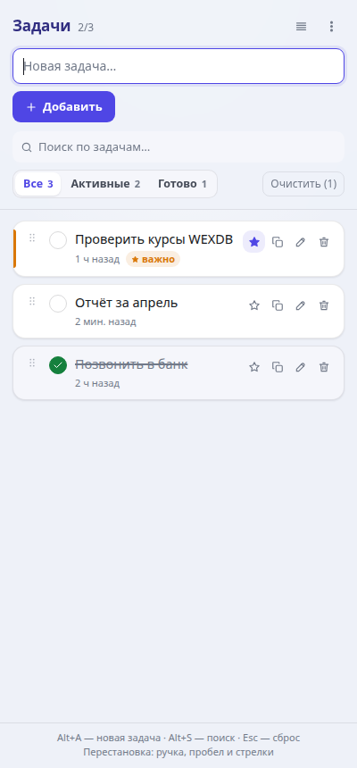
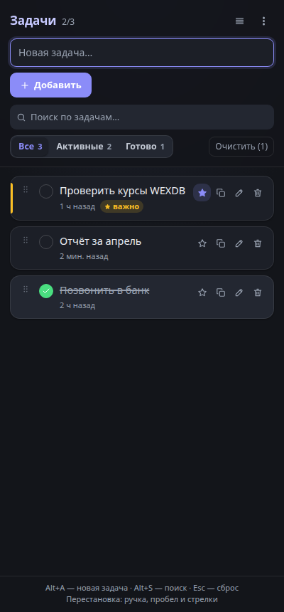

# Менеджер Задач — расширение Chrome

Список задач в боковой панели Chrome: всегда под рукой, не отвлекая от вкладки.
Без аккаунта, без сети, без телеметрии — данные лежат в `chrome.storage.local`
этого браузера.

<p align="center">
  
  
</p>

## Возможности

- **Боковая панель** — открывается кликом по иконке или `Ctrl+B` (`⌘B` на macOS),
  живёт рядом с текущей вкладкой.
- **Задачи**: добавить (`Enter`), изменить, отметить выполненной, удалить с
  подтверждением.
- **Высокий приоритет** — флажок и бейдж «важно», без влияния на порядок.
- **Порядок** — перетаскиванием за ручку, с клавиатуры (пробел + стрелки, пробел —
  отпустить) и на тач-устройствах.
- **Фильтры и поиск** — «Все / Активные / Готово» со счётчиками, поиск по всем
  словам запроса с подсветкой совпадений.
- **Экспорт и импорт** JSON — резервная копия и перенос между браузерами;
  импорт спрашивает подтверждение и умеет отменяться.
- **Отмена** последнего удаления, очистки выполненных и импорта — из уведомления.
- **Компактный вид** и **тёмная тема** (по системной настройке).
- **Клавиатура**: `Alt+A` — новая задача, `Alt+S` — поиск, `Esc` — отмена
  редактирования/поиска/диалога.
- **Локализация** — русский и английский.

## Установка

Пока расширение не опубликовано в Chrome Web Store. Локальная сборка:

```bash
npm ci
npm run build          # dist/ + release/crx-chrome-task-manager-<версия>.zip
```

Затем `chrome://extensions` → включить «Режим разработчика» → «Загрузить
распакованное расширение» → выбрать `dist/`.

Требуется Chrome **116+** (для закрытия панели программно нужен 141, до этого
используется обходной путь).

## Приватность и разрешения

Разрешений всего два:

| Разрешение | Зачем |
| --- | --- |
| `sidePanel` | Показать интерфейс в боковой панели |
| `storage` | Хранить задачи и настройки локально |

Нет доступа к вкладкам, истории, закладкам и сети: расширение не делает ни одного
сетевого запроса. Подробности — в [PRIVACY.md](PRIVACY.md).

## Разработка

```bash
npm run dev         # Vite + CRXJS, HMR для popup/панели
npm run typecheck   # tsc -b
npm test            # юнит-тесты (vitest)
npm run build       # сборка + zip
npm run validate    # статические проверки собранного расширения
npm run verify      # typecheck + test + build + validate
npm run load-test   # Chrome: загрузка расширения, панель, popup, локали, темы
npm run e2e         # Chrome: полный сценарий работы с задачами
```

Браузерные проверки ищут Chrome for Testing в `CHROME_BIN`, `tools/chrome-linux64`,
кэше Playwright. Стандартный Chrome с версии 137 игнорирует `--load-extension`,
поэтому он не подходит. Подробности и ручной чек-лист — в
[docs/testing.md](docs/testing.md).

## Архитектура

```
src/
├── background/service-worker.ts   состояние панели по окнам (события + порт)
├── lib/
│   ├── tasks.ts                   чистая логика: сортировка, фильтры, поиск, импорт
│   ├── storage.ts                 chrome.storage + миграция из 1.x и 3.0
│   ├── panel.ts                   open/close с fallback'ами для старых Chrome
│   ├── i18n.ts                    обёртка над chrome.i18n
│   └── storageKeys.ts             ключи и версия схемы
├── hooks/
│   ├── useStore.ts                единственный источник состояния задач
│   └── usePanelPort.ts            порт панель→SW с переподключением
├── components/                    UI (список, форма, фильтры, меню, диалог, тосты)
├── sidepanel/                     страница боковой панели
└── popup/                         popup с состоянием панели и горячей клавишей
```

Ключевые документы:

- [docs/knowledge-base.md](docs/knowledge-base.md) — проверенные факты о
  `chrome.sidePanel`, `chrome.storage` и локалях в headless; разбор дефектов
  прошлых версий и ловушек инструментов.
- [docs/decisions.md](docs/decisions.md) — ADR: почему один ключ сортировки, как
  устроена миграция, почему разрешений только два.
- [docs/testing.md](docs/testing.md) — четыре слоя проверок и что каждый ловит.

## Ограничения

- Список не синхронизируется между устройствами: `chrome.storage.local` живёт в
  браузере (для переноса есть экспорт/импорт).
- Задачи не хранят историю изменений; отмена доступна для последнего
  разрушительного действия.
- Лимиты: 500 символов на задачу, 2000 задач.
- На системных страницах (`chrome://…`) боковую панель открыть нельзя — это
  ограничение Chrome, расширение честно сообщает об этом.

## Лицензия

MIT — см. [LICENSE](LICENSE).
